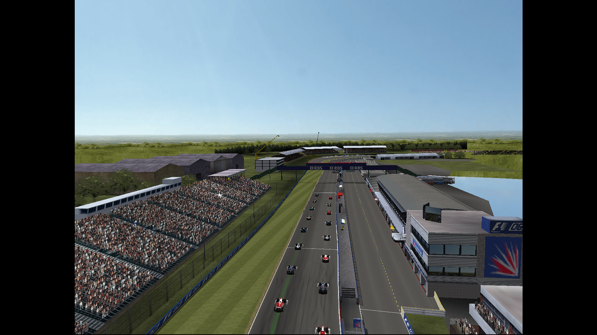
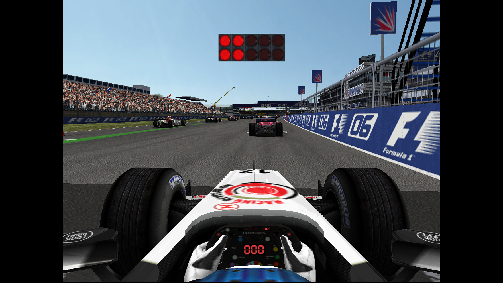
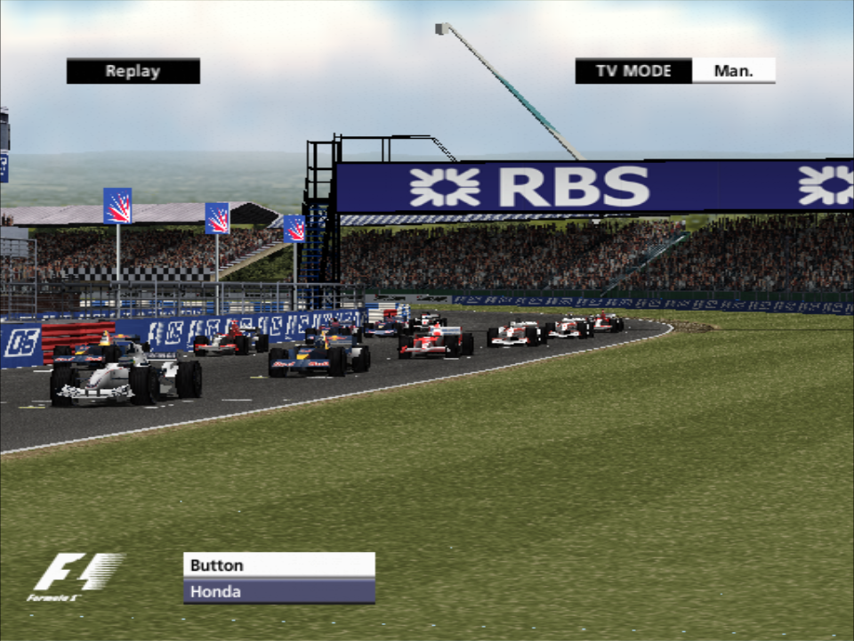
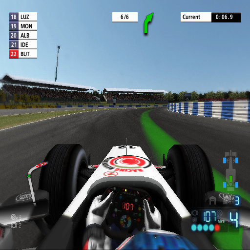
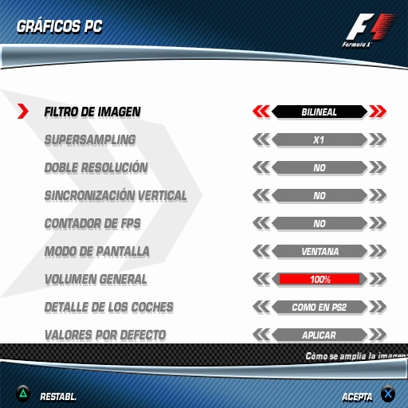

# F1 06 PC: a native Windows port of Formula One 06 (PS2) by static recompilation

> **Fan project. Not affiliated with, endorsed by or connected to Sony Interactive Entertainment, SCE Studio Liverpool,
> Formula One Group, the FIA or any other rights holder.** No game data is distributed: you need your own copy of the
> game. [Español más abajo](#español).

**F1 06 PC** turns the European PlayStation 2 release of *Formula One 06* (PAL, SCES-53950) into a native Windows
program. This is not an emulator running the disc: the game's MIPS code (about 14,000 functions) is translated ahead
of time into C++ with [PS2Recomp](https://github.com/ran-j/PS2Recomp) and compiled into a normal `.exe`, together with
a runtime that stands in for the PS2 hardware (EE, IOP, VU1, SPU2) and draws the GS graphics on your graphics card
through [paraLLEl-GS](https://github.com/Arntzen-Software/parallel-gs) (Vulkan). On top of a faithful 1.0 base (the
full PS2 game, all 18 circuits, championship, split screen), it adds PC options that live inside the game's own menus,
with its own fonts, colours and controller navigation: no overlays, no external launchers.

## Highlights

- **Native PC executable** built by static recompilation, running at **50 fps like the PAL original**.
- **GPU rendering** (paraLLEl-GS over Vulkan) with supersampling (x1 to x16), double resolution and image filters
  (nearest, bilinear, sharp, AMD FSR 1, CRT); software (CPU) mode as a fallback.
- **Display**: window, borderless or fullscreen, the game's own **widescreen 16:9** option, aspect auto / 4:3 / 16:9 /
  square pixels, VSync, FPS counter, **wider field of view** (+5 % to +30 %) for the race cameras.
- **Beyond-PS2 detail**: a CAR DETAIL option with REDUCED, AS ON PS2 (default), HIGH or MAXIMUM, where every car is
  drawn with the player car's full detail, and a SCENERY DISTANCE option (AS ON PS2, FAR, VERY FAR) that pushes the scenery fade
  distances further out.
- **Photo mode**: freezes the race, free camera, switch to any car and any race camera; **replays** with rewind and
  fast-forward.
- **PNG screenshots** (F12), race **HUD** full / minimal / hidden, **fast loads** (race load about 2 s shorter, back to
  menu about 3.5 s shorter, boot to title about 15 s shorter).
- **Finer AI difficulty** (11 steps from EASY to HARD), **crash damage also in short races** (1-3 laps), colour-blind
  filters, mono audio, audio latency and vibration strength settings.
- **Controllers**: DualSense (with vibration), DualShock 4, XInput pads and a fully configurable keyboard
  (`config\controles.ini`). Two players in **split screen**.
- **Steering wheel**: a Logitech G29 is presented to the game as its own *Driving Force Pro*, with the game's native
  steering, pedals, menu buttons and **force feedback**.
- **Netplay over IP (experimental)**: one PC hosts and runs the game; a second PC joins as player 2 of split screen,
  receiving image and sound. LAN or private VPNs (Tailscale, ZeroTier); every packet is signed with a password.
- **Mods folder**: loose files in `mods\` replace the disc file with the same path.
- **Autonomous testing**: 842 unit tests and scripted full-game regressions (all game modes, the 18 circuits,
  championship save/load), checked with screenshots and logs.

## Screenshots

| | |
|---|---|
|  |  |
| *Silverstone grid, 22 cars, SCENERY DISTANCE: VERY FAR* | *Start lights from the cockpit, CAR DETAIL: MAXIMUM* |
|  |  |
| *Replay, TV camera* | *In race, cockpit camera and HUD* |
|  | |
| *PC GRAPHICS, a native page in the game's OPTIONS menu* | |

Screenshots are in-game captures from the game's own data; the trademarks and logos visible in them belong to their
owners.

## Requirements

- Windows 10 or 11, 64-bit.
- A graphics card with Vulkan for the normal (GPU) mode; without it the game draws in software mode (slower).
- **Your own copy of Formula One 06 for PS2, European PAL version (SCES-53950)**, dumped from your own disc to an
  `.iso` file.
- CPU: no minimum has been measured yet. The race start with 22 cars is the most demanding moment and depends on the
  processor's clock speed (see *Known limitations*). [VERIFICAR: minimum or recommended CPU]

## Installation

1. Download either the **installer** (`.exe`) or the **portable** `.zip` from the release page (RELEASE_URL).
   - Installer: creates "F1 06 PC" shortcuts in the Start menu and on the desktop; uninstall from Settings > Apps (it
     asks whether to also delete your saves and options). Your saves and settings go to
     `Documents\My Games\F1-06`. One installer page lets you pick your ISO (already filled in if one is found in your
     Downloads or on your Desktop) and copies the game data during the installation; leave it blank to do it on the
     first run instead.
   - Portable: unzip the folder anywhere and open `F1-06.exe`. Everything is saved inside that folder, so you can
     move it or carry it on a USB stick.
2. **First run**: if the game data is not there yet, the game asks once for your Formula One 06 ISO. It offers an ISO
   found in your Downloads folder, on your Desktop or next to the `.exe` (or lets you browse for one), checks that it
   is the PAL version (SCES-53950), copies the game data with a cancellable progress bar (about 4 GB: portable, into
   `datos\` next to the `.exe`; installed, into `%LOCALAPPDATA%\F1-06\datos`) and starts. The ISO is only read.
   After that you just play.
3. Windows may show "Windows protected your PC" (SmartScreen) because the `.exe` is not signed: click **More info**
   and then **Run anyway**.

Dump your own disc: the project will never tell you where to download a game image, and does not ship one.

## Controls and options

- All PC options are in **OPTIONS > PC OPTIONS** in the main menu, with four pages: **PC GRAPHICS**, **PC DISPLAY**,
  **PC SETTINGS** and **PC NETPLAY**. Each page has a DEFAULT VALUES row. Changes are visible at once; ACCEPT saves them to
  `config\opciones.ini`. The race pause menu also has PC GRAPHICS and PHOTO MODE.
- Keys: **F11** fullscreen / window, **F10** aspect, **F12** screenshot, **H** HUD mode, **F8** photo mode. With a
  controller, **R3** enters and leaves photo mode and **L3** shows or hides the help bar. Close the window (X or
  Alt+F4) to quit; Esc never closes the game.
- Photo mode: left stick moves the camera, right stick turns it, R2/L2 up/down, L1/R1 tilt, d-pad up/down zoom,
  d-pad left/right changes car, △ cycles the race cameras, ○ takes the photo, START returns to the race (keyboard:
  W S A D, R F, arrows, Q E, Z X, TAB, V).
- Replays: SELECT pauses, R2 fast-forward (x2, then x4), L2 rewinds (keyboard: K, L, J).
- Controls are configured in `config\controles.ini` (pad, keyboard, wheel; a `[jugador2]` section for the second
  player). Wheel settings in its `[volante]` section: set `grados_volante` to the rotation configured in G HUB (900
  by default); `giro` is the lock-to-lock range the game uses (200 by default, like the original Driving Force Pro).
- Netplay: the host turns HOST on in PC NETPLAY and tells the guest the address, port (TCP 50650 by default) and
  password; the guest opens `Jugar en red - Invitado.cmd` (installed: "F1 06 PC - Jugar en red (invitado)" in the Start
  menu; or `F1-06.exe --invitado`) and does not need the game data. Image
  quality low / medium / high uses about 4 / 8 / 15 Mbit/s. Full details in `LEEME.txt` inside the package (Spanish).

## Known limitations

- **Race start performance**: the game runs at 50 fps, but with Windows' *Balanced* power plan and other programs
  open, the start with 22 cars can drop to about **42-45 fps for a few seconds**. Use the *High performance* power
  plan or close what you don't need to stay at 50.
- **CAR DETAIL: HIGH** costs about 16 % more CPU time at the start (measured 45.2 vs 48.6 fps) and **MAXIMUM**
  about 1.9 times as much (around 25 fps at the start); FAR and VERY FAR scenery cost about 5 % and 9 %. AS ON PS2 is the default.
- No 60 fps mode (the game runs at the PAL 50 fps). Internal resolution is the PS2's (paraLLEl-GS can double it);
  higher resolutions are upscaled.
- **Netplay is experimental**: two players only (it streams the host's split screen to the guest), tested on one PC
  over 127.0.0.1 so far; a test across two PCs with a real firewall is pending. Traffic is signed but **not
  encrypted**: outside your home, use Tailscale or ZeroTier rather than opening a port.
- The original game had no online mode; this port does not add one (yet).
- DualShock 4 vibration does not work. [VERIFICAR: still true]
- The executable is not code-signed, so SmartScreen warns on first run.

## FAQ

**Why do I need my own ISO?**
The game's code, graphics, sounds and music belong to their rights holders. This project only distributes its own
work: the recompilation tooling and runtime changes. The executable needs the original game data to run, and the only
legal way to get it is from a disc you own.

**Is it legal?**
The project ships no game data, no ISO and no BIOS, and is not a commercial product. Making a personal backup of a
game you own is treated differently from country to country, so check your local law. If you are a rights holder and
have a concern, please open an issue at https://github.com/KevinL50-sysadmin/F1-06-PC/issues.
[VERIFICAR: contact method for rights holders]

**Is there online play?**
Not over the internet with accounts. Today there is experimental 2-player netplay between two PCs. Online play with
accounts and community servers is something we would like to explore in the future, but it is a goal, not a promise.

**Is this an emulator?**
No. An emulator interprets the PS2 program while it runs; here the game's code was translated to C++ and compiled
for x86-64 ahead of time. Parts of the hardware (graphics synthesiser, sound, I/O processor) are still reproduced by
the runtime, so you can think of it as a native game with a small PS2 "operating layer".

**Which version of the game works?**
Only the European PAL release, SCES-53950. Other regions use a different executable and are not supported.

## Support the project

If you'd like to support the work, there is a Ko-fi: **https://ko-fi.com/kevinl50**. Donations fund the time spent on the port, the
tools behind it and, hopefully one day, community servers. They never buy builds, features or game content:
everything stays free for everyone.

Bug reports are just as valuable
([issues](https://github.com/KevinL50-sysadmin/F1-06-PC/issues)): please attach `F1-06.log` (portable: `registros\` inside the game folder; installed:
`%LOCALAPPDATA%\F1-06\registros`).

## Legal notice

*Formula One 06* is © its respective owners. "Formula One", "Formula 1", "F1", "PlayStation", "PS2" and related marks
are trademarks of their respective owners and are used here only to describe what the project is compatible with.
This is an independent, non-commercial fan project. It is not affiliated with, endorsed by or sponsored by Sony
Interactive Entertainment, SCE Studio Liverpool, Formula One Group, the FIA or any other rights holder. No game
assets, ISO images or BIOS files are distributed; no official logo is used as project branding.

## Credits and third-party software

- **[PS2Recomp](https://github.com/ran-j/PS2Recomp)**: the PlayStation 2 static recompiler and runtime this port is
  built on (GPL-3.0). This project's changes to it are kept as patches in `parches/`.
- **[paraLLEl-GS](https://github.com/Arntzen-Software/parallel-gs)**: GS rendering on the GPU with Vulkan (LGPL-3.0
  or later), with **[Granite](https://github.com/Themaister/Granite)** (MIT), **volk** (MIT) and **Vulkan-Headers**
  (Apache-2.0 or MIT). Full source and licenses ship in the package's `licencias\` folder.
- **[raylib](https://github.com/raysan5/raylib)** (zlib) and **[Dear ImGui](https://github.com/ocornut/imgui)** (MIT),
  pulled in by PS2Recomp's runtime; other PS2Recomp build dependencies: fmt, ELFIO, toml11, libdwarf, rabbitizer,
  nlohmann/json (each under its own license).
- **AMD FidelityFX Super Resolution 1** (EASU and RCAS, MIT), adapted to GLSL for the FSR image filter.
- **FFmpeg** DLLs for the game's videos (LGPL).
- **Michroma** font (SIL Open Font License 1.1), used for the port's on-screen notices.
- Modelled on the god-of-war-recomp project [VERIFICAR: link], with ideas (never code) taken from the F1
  Championship Edition PS3 recompilation.
- Thanks to SCE Studio Liverpool for the original game, and to the PS2 preservation and recompilation communities.

Project license: [GNU GPL-3.0](LICENSE), the same as PS2Recomp, which the runtime derives from. The license
covers the port's own code only; Formula One 06 and its data belong to their owners and are never included.

## Building from source (developers)

Source: https://github.com/KevinL50-sysadmin/F1-06-PC. The repository holds only the project's own work:
`src/` (game-specific overrides), `parches/` (patches over PS2Recomp), `gpu/pgs_puente/` (the paraLLEl-GS bridge
DLL), `config/recomp.toml`, `scripts/` (build, packaging and analysis tools; comments in Spanish) and the root `.cmd`
build scripts. It never contains game data.

Outline (Windows, from the project root) [VERIFICAR: full clean-checkout procedure, including the PS2Recomp base
commit the patches apply to]:

1. Clone PS2Recomp into `third_party\PS2Recomp` and apply `parches\*.patch` in order.
2. Put portable MSVC, Windows SDK, CMake and Ninja in `tools\` (`entorno.cmd` sets up a console with them).
3. `compilar-ps2recomp.cmd` builds PS2Recomp in `build\ps2recomp`.
4. Extract your own disc into `juego\` (`scripts\iso_ps2.py`), then `recompilar.cmd` translates `juego\SCES_539.50` to
   C++ and builds the executable (`compilar-runner.cmd` rebuilds it after changes in `src\`).
5. `scripts\obtener-parallel-gs.ps1` fetches paraLLEl-GS at the pinned commit and builds `pgs_puente.dll`.
6. `ejecutar.cmd` runs the development build; `scripts\empaquetar.ps1` makes the portable package and installer.

---

## Español

> **Proyecto de fans. Sin relación con Sony Interactive Entertainment, SCE Studio Liverpool, Formula One Group, la FIA
> ni ningún otro titular de derechos, ni respaldado por ellos.** No se distribuye nada del juego: necesitas tu propia
> copia.

**F1 06 PC** convierte la edición europea de PlayStation 2 de *Formula One 06* (PAL, SCES-53950) en un programa nativo
de Windows. No es un emulador que lee el disco: el código MIPS del juego (unas 14.000 funciones) se traduce de
antemano a C++ con PS2Recomp y se compila en un `.exe` normal, con un runtime que hace de hardware de la PS2 y dibuja
los gráficos en tu tarjeta gráfica con paraLLEl-GS (Vulkan). Sobre una base 1.0 fiel (el juego completo, los 18
circuitos, el campeonato, la pantalla partida) añade opciones de PC dentro de los propios menús del juego, con su letra,
sus colores y manejo con mando: sin ventanas superpuestas ni lanzadores.

**Funciones:** 50 fps como el original PAL; supersampling, doble resolución y filtros (FSR 1, CRT, nítido...);
panorámico 16:9 del propio juego y campo de visión hasta +30 %; DETALLE DE LOS COCHES (REDUCIDO, COMO EN PS2, ALTO,
MÁXIMO) y DISTANCIA DEL ESCENARIO (COMO EN PS2, LEJOS, MUY LEJOS); modo foto con cámara libre; repeticiones con
atrás y adelante; fotos en PNG; HUD ocultable; cargas rápidas; IA en 11 niveles; daños también en carreras cortas;
DualSense, DualShock 4, mandos XInput y teclado; volante G29 como el Driving Force Pro del juego, con fuerza de
respuesta; pantalla partida y juego en red por IP (experimental); carpeta `mods\`; pruebas automáticas (842 tests y
regresiones completas guionizadas).

**Requisitos:** Windows 10/11 de 64 bits, tarjeta gráfica con Vulkan (sin ella, modo Software, más lento) y **tu
propia copia de Formula One 06 PAL (SCES-53950)**, volcada de tu disco a una `.iso`.

**Instalación:** descarga el instalador o el `.zip` portable (RELEASE_URL). El instalador crea los accesos "F1 06 PC"
y puede copiar los datos de tu ISO durante la instalación. Si no, la primera vez el juego te pide la ISO una sola vez
(te ofrece la que encuentre en Descargas o en el Escritorio, o la buscas tú), comprueba que es la PAL (SCES-53950),
copia los datos con una barra de progreso y arranca; después, a jugar. La ISO solo se lee. Si Windows avisa con SmartScreen ("Windows protegió su PC"), pulsa "Más información" y "Ejecutar de todas
formas". Vuelca tu propio disco: el proyecto no dice dónde descargar imágenes de juegos ni las distribuye.

**Opciones:** OPCIONES > OPCIONES PC (GRÁFICOS PC, PANTALLA PC, AJUSTES PC, JUEGO EN RED PC). Teclas: F11 pantalla
completa, F10 aspecto, F12 foto, H HUD, F8 o R3 modo foto. Todo explicado en `LEEME.txt` dentro del paquete.

**Limitaciones conocidas:** con el plan de energía Equilibrado y programas abiertos, la salida con 22 coches puede bajar
a 42-45 fps unos segundos (con Alto rendimiento, 50); DETALLE ALTO cuesta un 16 % y MÁXIMO va a unos 25 fps en la
salida; sin 60 fps; el juego en red es experimental (2 jugadores, firmado pero sin cifrar; falta la prueba en dos PC
con cortafuegos real); el `.exe` no está firmado.

**Online:** hoy hay juego en red experimental para 2 PC. Un online con cuentas y servidores comunitarios es algo que
nos gustaría explorar en el futuro: un objetivo, no una promesa.

**Apoyo:** Ko-fi en **https://ko-fi.com/kevinl50**. Las donaciones apoyan el trabajo del port, las herramientas y, ojalá, futuros
servidores comunitarios; nunca compran versiones, funciones ni contenido del juego: todo sigue gratis para todos.

**Aviso legal:** proyecto de fans independiente y sin ánimo de lucro. *Formula One 06* y las marcas "Formula One",
"F1", "PlayStation" y relacionadas pertenecen a sus dueños y solo se nombran para describir la compatibilidad. No se
distribuyen recursos del juego, ISO ni BIOS, ni se usa ningún logotipo oficial como imagen del proyecto.

**Créditos:** PS2Recomp (GPL-3.0), paraLLEl-GS (LGPL-3.0+), Granite, volk y Vulkan-Headers, raylib, Dear ImGui, AMD FSR 1,
FFmpeg y la letra Michroma (OFL 1.1); detalles y licencias en la sección en inglés y en `licencias\` del paquete.
